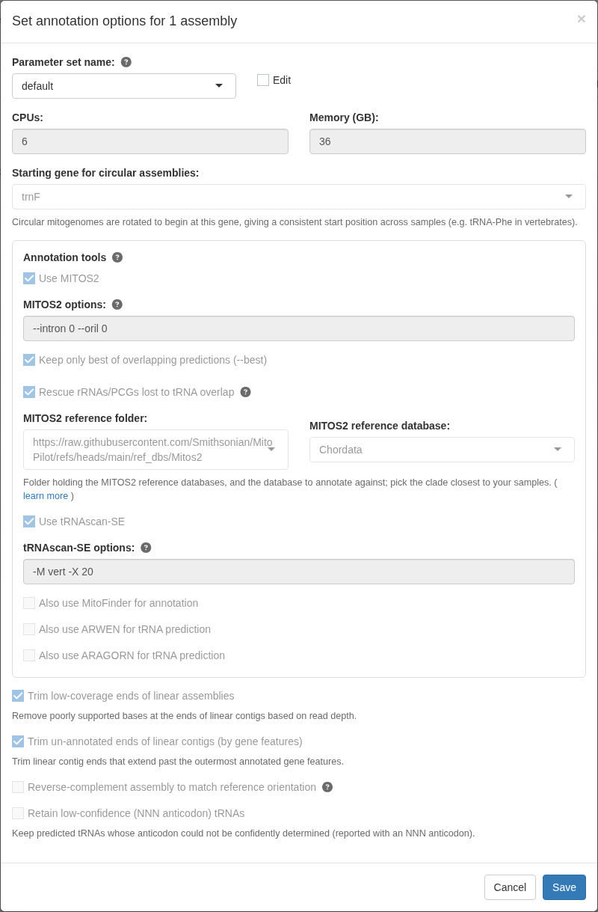

# Test Project: Annotate

Test project: [0.
Initialize](https://nmnh-oceandna.github.io/MitoPilot/articles/MitoPilot.md)
[1.
Assemble](https://nmnh-oceandna.github.io/MitoPilot/articles/Test-Project-Assemble.md)
2. Annotate [3.
Export](https://nmnh-oceandna.github.io/MitoPilot/articles/Test-Project-Export.md)

This module finds the genes, curates the gene models against reference
sequences from GenBank, and validates the result against rules for your
taxonomic group. It attempts to flag any issues that would cause a
rejection during GenBank submission.

Each row here is one **assembly**, not one sample. A sample that kept
several scaffolds or paths will be represented by several rows, and each
is annotated and validated on its own.

## Set the options

**Annotate Opts.** controls the annotation tools.

Annotation options window

Genes come from [MITOS2](https://gitlab.com/Bernt/MITOS) (protein-coding
genes, tRNAs, and rRNAs) and
[tRNAscan-SE](https://github.com/UCSC-LoweLab/tRNAscan-SE) (tRNAs), with
MitoFinder, ARWEN, and ARAGORN available as optional annotators. The
MITOS2 reference database defaults to `Chordata`, but `Metazoa_RefSeq89`
is the general-purpose choice for other groups. The defaults suit most
vertebrates. For other clades, or when genes come back missing or on the
wrong strand, see [handling difficult
annotations](https://nmnh-oceandna.github.io/MitoPilot/articles/Difficult-Annotations.md)
for which settings to change.

**Curate Opts.** controls what MitoPilot does with those raw
annotations.

Curation options window showing the taxonomic ruleset

The setting that matters most is **Target**, the taxonomic ruleset. It
sets the expected gene content, the allowed start and stop codons, the
naming conventions, and the genetic code. It defaults to Actinopterygii,
which is correct for the test fishes.

For your own data, pick the closest clade from the [ruleset
browser](https://nmnh-oceandna.github.io/MitoPilot/articles/Ruleset-Browser.md).
Expand **Curation rules for this ruleset** to see the validation
parameters, which are the ruleset itself, laid out so you can see
exactly which rules an assembly is being judged against.

**ORF Opts.** controls an optional search for open reading frames (ORFs)
that the annotation tools did not report.

It is off by default, and the test fishes do not need it. Tick **Run ORF
finder step** to have [NCBI
ORFfinder](https://www.ncbi.nlm.nih.gov/orffinder/) scan the unannotated
regions of each assembly after curation. Three settings shape what it
reports:

- **Min ORF length (nt)**: the shortest ORF reported (default 300).
- **Max overlap w/ existing annotations**: how much of an ORF may
  overlap a gene that is already annotated (default 0.1, or 10% of the
  ORF’s length).
- **Include nested/overlapping ORFs**: also report ORFs inside or
  overlapping another ORF, not only the longest one in each region.

The genetic code comes from the curation ruleset. Each ORF found is
added as a new row in the annotation table, where **Auto-assign ORFs**
can name the ones that match a known gene. See [handling difficult
annotations](https://nmnh-oceandna.github.io/MitoPilot/articles/Difficult-Annotations.html#look-for-unannotated-open-reading-frames-orfs)
for when this helps.

**No ruleset for your samples?** If you do not see an appropriate clade
for your samples, please post an
[issue](https://github.com/NMNH-OceanDNA/MitoPilot/issues) or reach out
to Dan MacGuigan directly at <macguigand@si.edu>. We are always looking
to expand the taxonomic scope of MitoPilot.

When ready, click **Update** and run the workflow the same way you ran
Assemble.

This module is slower than Assemble. MITOS2 takes a few minutes per
assembly, and curation aligns every protein-coding gene against
reference sequences. When working on a computing cluster with your own
project, consider running this step as a job rather than directly from
the MitoPilot app.

## Read the results

Annotate table showing missing genes, extra genes, and warning counts

Scroll right in the table for the columns that matter:

- **\# PCGs, \# tRNAs, \# rRNAs**: how many of each gene type were
  annotated. For a vertebrate mitogenome you expect 13, 22, and 2.
- **Missing**: expected genes that were not found.
- **Extra**: genes annotated more times than the ruleset expects.
- **Warnings**: how many validation flags were raised. This is your work
  queue.

A few assemblies stand out in the test project. For example, SRR21844202
has an extra `trnW` and two warnings.

SCAFFJOIN is missing `atp8`, `trnK`, and `trnL` and carries ten
warnings. This is a real consequence of joining scaffolds across
coverage gaps. The sequence in those gaps is set to “N”, so the genes in
those gaps cannot be annotated.

**Note.** The **Warnings column includes** dropdown menu at the top
filters which warning types are counted. Narrow it to one warning type
to pull out every assembly with that problem and work through them as a
batch.

## Inspect a sample

Click **Details** on any row. Here we’ll look at sample SRR19434536.

Annotation details window with the gene table

The annotation table lists every gene with its position, strand, and the
tool that called it. The **Notes** column records changes made during
automatic curation, such as a start position moved upstream or a stop
codon trimmed. **Warnings** shows what validation flagged. The `nt` and
`aa` buttons copy the nucleotide or amino acid sequence to your
clipboard.

The badge beside the title shows the topology. The four buttons under
it, **ID verified**, **Reviewed**, **Problematic**, and **Partial**, are
flags: click one to set or clear it. A flag that is set is filled in.
This is how you keep track of what you have already looked at across a
large project.

Below the table are four collapsible sections: Sequence, BLAST Reference
Synteny, Alignment, and Notes.

**Sequence** shows the assembly itself: read depth and per-base error
rate along it, the genes as arrows in lanes below them, then the
nucleotides and the translated amino acids of each protein-coding gene
once you zoom in. Each track can be hidden with its checkbox. Error rate
bars turn orange above 5%, a sign of possible sequencing or assembly
errors. Click a row in the table to jump to that gene, or use Whole
genome to step back out. The view follows every edit you make in this
window.

Coverage map with gene models drawn over read depth

**BLAST Reference Synteny** lines your annotation up against the closest
GenBank mitogenome, with a percent-identity bar between them. Drag or
scroll sideways to pan and scroll or pinch to zoom; zoomed in far
enough, the bases of your sample and the reference appear with
mismatches and gaps coloured. Click a gene in the sample track to select
it in the table. Click a gene in the reference track to zoom to it, then
use **Liftover** to copy it to your assembly; see [Add a missing gene
from the reference](#add-a-missing-gene-from-the-reference).

The reference mitogenome shown in this plot is recorded in the export’s
`sample_info.csv` in the `ref_accession` column, as its GenBank
accession number. It is not written to the FASTA headers. If the
reference mitogenome is a poor match, you can flag it (the CSV column is
then left blank) or use the dropdown menu to pick a better reference
from among the top BLAST hits.

Gene order compared against the closest GenBank reference

**Alignment** shows a selected protein-coding gene aligned to its
reference hits and the curation database.

Protein alignment of a gene against its reference hits

The nucleotide boundary box shows the exact sequence at each end of the
gene with the codon frame marked, along with the start and stop codons
that were called. Below it, the protein alignment shows your gene
(“focal”) alongside the reference proteins.

**Notes** is a free-text box for recording what you did. It saves
automatically and is kept with the assembly.

## Manually fix annotations

If many assemblies share the same problem, change a setting and re-run
before editing by hand; see [handling difficult
annotations](https://nmnh-oceandna.github.io/MitoPilot/articles/Difficult-Annotations.md).
Re-running replaces manual edits, so do it first.

Click **Edit** in the alignment section to nudge the start or stop
position and watch the alignment respond.

Alignment-based annotation editing

By default, the `+` and `-` buttons search for the next valid start or
stop codon (according to the curation ruleset you selected). You can
tick the **single codon** checkbox to instead nudge the position one
codon at a time. This can lead to a **partial** gene model with
undetermined start or stop codons.

Clicking the `poly-A stop` button will truncate a stop codon to **TA**
or **T**. Sometimes this is required by GenBank to avoid overlapping
gene models. When transcribed, these genes will have their stop codon
completed by the addition of the 3’ poly-A tail.

You can manually set a gene to have an undetermined start or stop codon
by clicking the Partial `5'` or `3'` buttons. MitoPilot will add the
appropriate format and notes for that gene in the GenBank submission
files. Best to use this sparingly, as GenBank may not accept a
submission with many “partial” gene models.

Other useful editing tools:

- **Merge PCGs/rRNAs** joins gene models that were split into separate
  pieces, which is how you handle spliced or fragmented genes.
- **Auto-assign ORFs** renames open reading frames found by ORFfinder
  based on sequence similarity with the curation database of
  protein-coding genes.
- **Delete** removes an annotation entirely. Bring back a deleted
  annotation using the **Restore** button.
- **Trim unannotated ends** cuts assembly overhang that carries no
  genes, can be undone.
- **Rotate** rotates a circular assembly to start on a feature you pick.
  Picking a feature on the minus strand also reverse-complements the
  assembly, after a warning. **Restore assembly** undoes it.
- **Linearize** converts a circular assembly to linear, useful when the
  control region assembled poorly.
- **Align fewer refs** in the Alignment panel speeds up editing by
  restricting the alignment to the top five hits, which matters because
  the alignment is recomputed on every start/stop codon nudge.

### Add a missing gene from the reference

If the annotator missed a gene that the closest reference has, you can
copy it over. Open **BLAST Reference Synteny** and click the gene in the
reference track. The plot zooms to it and the blue **Liftover** button
next to the zoom buttons takes on the gene’s name. Click it to find
where that gene sits in your assembly.

Liftover dialog with placements, alignment, and synteny view

The table lists up to three placements, best first, with position,
strand, identity, gaps, and any existing genes the placement overlaps.
Pick one to see the reference gene aligned to it. tRNAs and rRNAs are
shown as nucleotides; protein-coding genes are shown as protein when the
placement starts with a valid start codon. The synteny view outlines the
reference gene and every placement in bright green, with the selected
placement drawn thicker.

Two boxes set the quality cut-offs: **Min identity %** (default 85,
never below 80) and **Max gaps %** (default 5, never above 10).
Placements that miss the cut-offs are greyed out and cannot be chosen.

Click **Add annotation** to add the placement as a new row. The tool is
recorded as the reference accession plus `_liftover`, and the notes
record the identity and gaps. If the placement overlaps an existing gene
by more than a quarter of either gene’s length, or your sample already
has a gene with that name, you are asked to confirm first.

Some limits to keep in mind:

- tRNAs are curated in the app right away. Protein-coding genes and
  rRNAs are curated through a short Nextflow run on your own computer,
  using the container (or no-container install) set in your project’s
  `.config`. It usually takes under a minute; the first time also
  downloads the curation database into a `.liftover` folder in your
  project. You can cancel while it runs, and nothing is added. If
  curation fails, you are told why and can add the gene with a “curation
  skipped” warning.
- The new gene copies the strand of the reference gene, so a strand
  error in the reference record carries over. Check the strand against
  the neighboring genes in the synteny view.
- Deleting a lifted-over gene removes it for good; there is no
  **Restore**. Lift it over again to bring it back.
- Control regions and genes split into several pieces in the reference
  cannot be lifted over.

You can record what you did in the **Notes** section; it saves
automatically and is retained with the assembly.

**Warning.** Validation warnings do not disappear when you fix the
underlying problem. They record the state at the time the Annotate
module ran. Use the **Reviewed** toggle to track what you have actually
dealt with.

## Lock and move on

When you are satisfied, select the assemblies and click **Lock** to
release them to the Export module.

[Next: Export
→](https://nmnh-oceandna.github.io/MitoPilot/articles/Test-Project-Export.md)
