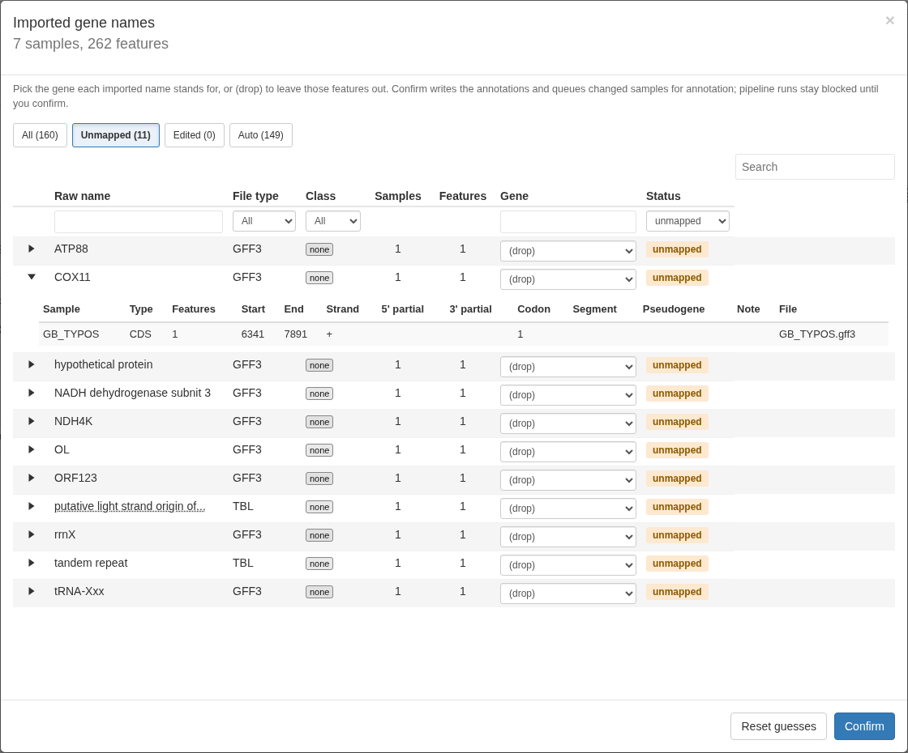
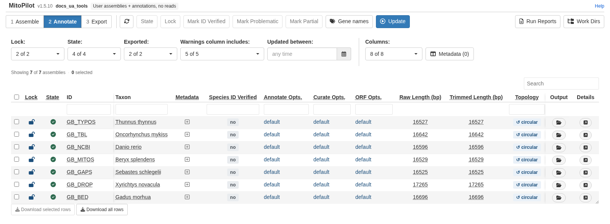
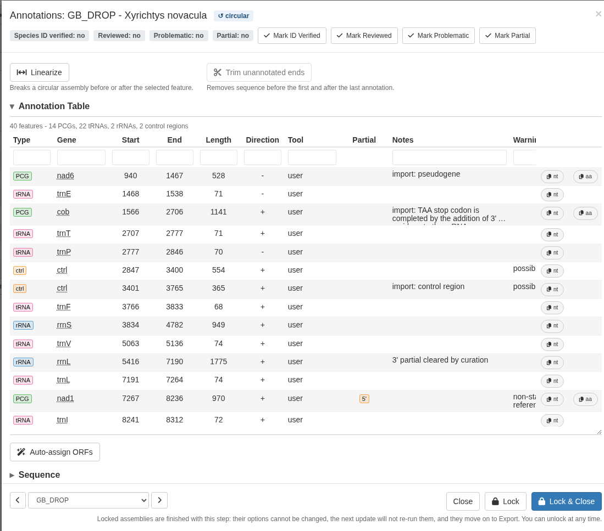
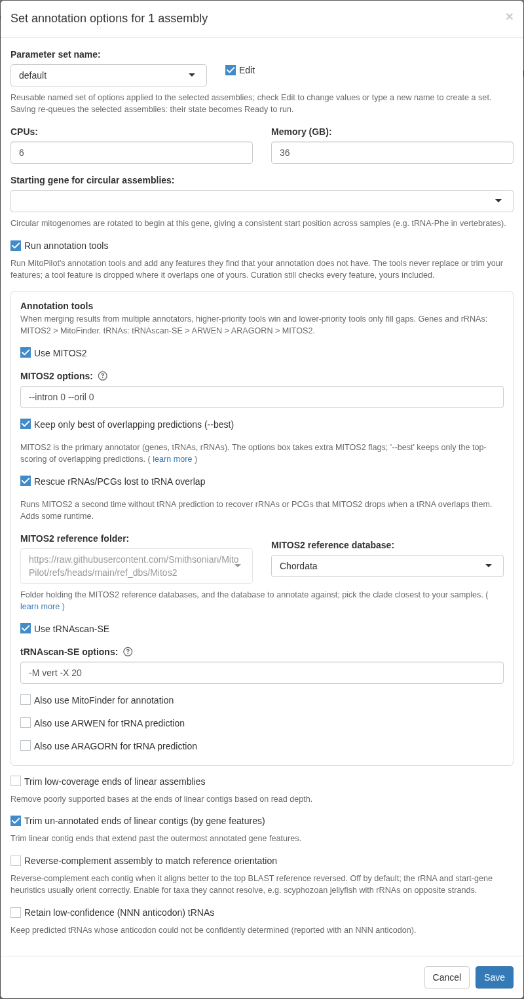
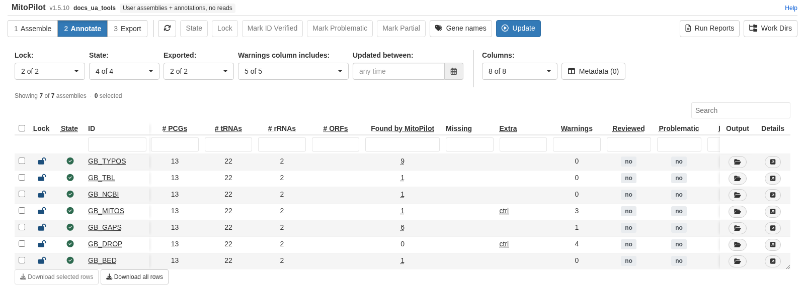
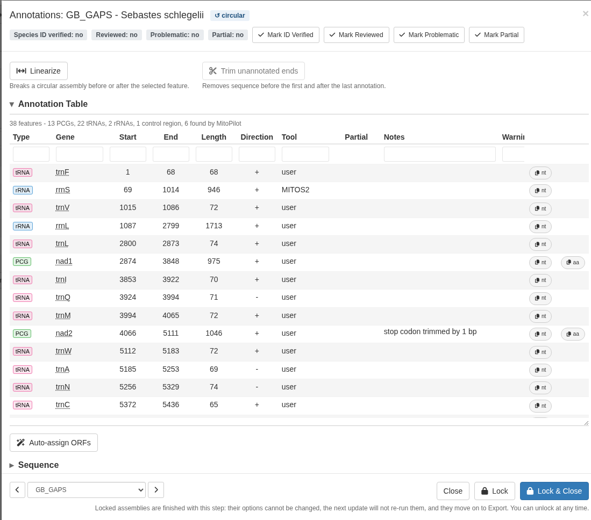

<style>
.alert {
  border-left: 5px solid;
  padding: 10px;
  margin: 10px 0;
  border-radius: 5px;
}
.alert-tip { border-color: #28A745; background-color: #E9F7EF; }
.alert-note { border-color: #007BFF; background-color: #EBF5FF; }
.alert-warning { border-color: #FFC107; background-color: #FFF9E6; }
.alert-danger { border-color: #DC3545; background-color: #F8D7DA; }
/* Smithsonian palette: blue #009CDE, yellow #FFCD00, black #101820 */
.alert-hydra {
  border-color: #101820;
  background-color: #E7F6FC;
  color: #101820;
}
.alert-hydra .hydra-tag {
  display: inline-block;
  background-color: #FFCD00;
  color: #101820;
  font-size: 0.75em;
  font-weight: bold;
  letter-spacing: 0.04em;
  padding: 1px 7px;
  border-radius: 10px;
  margin-right: 6px;
  vertical-align: 2px;
}
strong { font-weight: bold; }
img { max-width: 100%; border: 1px solid #ddd; border-radius: 4px; }
.figure { margin: 1.2em 0; }
.figure .caption, p.caption {
  font-size: 0.82em;
  line-height: 1.35;
  color: #6c757d;
  font-style: italic;
  margin-top: 0.4em;
}
.part-break {
  border: none;
  border-top: 3px solid #c9d1d6;
  margin: 2.2em 0 1.6em;
}
.step-nav {
  margin: 0 0 2.5em;
  padding-bottom: 1.2em;
  border-bottom: 1px solid #dde3e6;
}
.step-nav.no-rule {
  border-bottom: none;
  padding-bottom: 0;
}
/* pandoc wraps the row contents in a <p>, so that is the flex container. */
.step-nav p {
  margin: 0;
  display: flex;
  flex-wrap: wrap;
  align-items: center;
  gap: 8px;
}
.step-nav .step-label {
  font-weight: 600;
  color: #6b7b85;
  margin-right: 4px;
}
.step-nav a,
.step-nav .current {
  display: inline-block;
  padding: 6px 16px;
  border-radius: 6px;
  font-weight: 600;
  font-size: 0.95rem;
  text-decoration: none !important;
  border: 1px solid #c8dde5;
}
.step-nav a {
  background-color: #e4f0f4;
  color: #1f6f8b !important;
}
.step-nav a:hover,
.step-nav a:focus {
  background-color: #d3e7ee;
  color: #17566b !important;
  text-decoration: none !important;
}
.step-nav .current {
  background-color: #1f6f8b;
  color: #ffffff;
  border-color: #1f6f8b;
}
</style>

This page is for projects where you already have both a mitogenome assembly
and an annotation for every sample. Initialize such a project with `new_project_userAnnot()`.
MitoPilot will import your assembly and features, ask you to confirm the gene
names, then curates validate, and export the annotations them like any other project.

Read [Starting Your Own Project](Your-Own-Project.html) and
[Using Your Own Assemblies](Your-Own-Assemblies.html) first. This page covers
only what differs.

<div class="alert alert-tip">
<strong>Tip.</strong> `new_test_project_userAnnot()` builds a ready-to-run
test project consisting of NCBI RefSeq fish mitogenomes, with annotations in every
supported format and some gene names deliberately left for you to fix. Try it
before running your own data.
</div>

## Setting up the project

The mapping file takes the user-assembly columns (`Assembly` and `Topology`) plus one more (`Annotation`):

| Column | Contents |
|---|---|
| `Assembly` | File name of the assembly FASTA for the sample. Exactly one sequence per file. |
| `Topology` | Optional. `circular` or `linear`. Any sample with this unspecified defaults to `linear`. |
| `Annotation` | File name of the annotation for the sample: GFF3 (`.gff`, `.gff3`), BED (`.bed`), or a GenBank 5-column feature table (`.tbl`). |

The sequence ID inside each annotation must equal the first word of the FASTA
header. For an assembly whose FASTA header is `>NC_002333 Danio rerio mitochondrion`,
the ID is `NC_002333` and each format carries it like so:

GFF3, first column of every feature line:

```
##gff-version 3
NC_002333	RefSeq	gene	951	1019	.	+	.	ID=gene-trnF;Name=trnF
NC_002333	RefSeq	tRNA	951	1019	.	+	.	ID=rna-trnF;Parent=gene-trnF;product=tRNA-Phe
```

BED, first column of every line:

```
NC_002333	950	1019	tRNA-Phe	0	+
NC_002333	1019	1971	12S rRNA	0	+
```

GenBank feature table, the `>Feature` line at the top of the file:

```
>Feature NC_002333
951	1019	gene
			gene	trnF
951	1019	tRNA
			product	tRNA-Phe
```

Copies of your original files are kept in `<project>/user_annotations/raw/`.

```r
new_project_userAnnot(
  path = "~/my_annotated/run_01",
  mapping_fn = "~/my_annotated/mapping.csv",
  assembly_path = "~/my_annotated/fasta",
  annotation_path = "~/my_annotated/annotations",
  no_raw_data = TRUE
)
```

Reads are optional. With `data_path` and `R1`/`R2` columns, the Assemble module
maps them to calculate coverage. Specify `no_raw_data = TRUE` if you do not have sequence
reads for your samples.

Mitogenome identification, circularization, and scaffold joining are not available for
this project type, since any of them would shift the coordinates of your
annotation. Coverage trimming and start-gene rotation are off by default for
the same reason.

## What MitoPilot imports

Aside from the gene name and coordinates, MitoPilot will also attempt to import the
following information.

- Partial ends, reading frame (`codon_start`), and anticodons.
- Pseudogenes, with the note `import: pseudogene`.
- Free-text notes, as `import: <note>`. They are shown in the details window
  but not written on export.
- Introns and ribosomal slippage, as MitoPilot join groups. The feature-table
  export writes the `ribosomal_slippage` and `exception` qualifiers back.

`transl_except` is not stored. MitoPilot derives it from the shortened stop
codon the coordinates give, and export regenerates it.

Every other attribute or qualifier (e.g. locus_tag, db_xref, gbkey) is 
stored verbatim in project database table 
`user_annotations`. MitoPilot does not display or export these, they are kept
only for reference.

## Reviewing gene names

MitoPilot guesses a canonical gene name for every feature when the project is
created. The first time you open the app, the **Imported gene names** window
lists every name from your annotation files with its guess.



Fix any wrong guesses with the picker in the gene column or select `(drop)` for
any features you do not wish to include. Expand a row to see which
samples and features carry that name. Rows you edit count as Edited and leave
the Unmapped view. When you are finished, press **Confirm**.

Pipeline runs are blocked until you confirm. The app header shows a notice
with a **Review** button until then. Use the **Gene names** toolbar button
to reopen this window at any time. Confirming a second time re-queues only the samples whose
gene names actually changed.

Names MitoPilot cannot place, such as ORFs or the light-strand origin (OL). 
Control-region names (D-loop, control region, OH) import as MitoPilot's 
control region feature, `ctrl`, which exports as `D-loop`.

## Running the pipeline

Once the names are confirmed, start by running
**Update** in the Assemble module. This will only BLAST your mitogenomes and map sequence
reads (if available). Then lock the samples and run **Update** in the
Annotate module. 

By default, the Annotate workflow does not run any annotation tool. 
It simply curates and validates your imported annotations. 



After running the Annotate workflow, open the details window for each sample. 
Notes that start with
`import:` were carried over from your file. Any changes made by MitoPilot 
curation will also be recorded in the Notes column.



The Sequence and BLAST Reference Synteny viewers in that window draw your
original annotation as a muted track above the curated one, labelled with the
gene names from your file. A feature outlined in amber is one MitoPilot changed:
its coordinates or strand moved, curation dropped it, or its name was never
mapped. Hover an arrow for the reason and the coordinates as they appear in
your file. A name change alone (`COI` becoming `cox1`) is not marked. The track
follows the Linearize and Trim buttons; a feature a trim cuts through is drawn
clipped and marked as such. Untick "Original" in either viewer to hide it.

When done reviewing, you may continue with [Export](Test-Project-Export.html) as usual.

## Filling gaps with MitoPilot's tools

By default MitoPilot annotates nothing when you provide the annotations.
However, if your annotations are incomplete, MitoPilot's own tools can help fill the gaps. 

In the Annotate options window, tick **Run annotation tools**.
When it is on, the tools chosen in the Tools box run on each assembly.
If these tools identify a missing annotation, they add it to your sample.



Your annotations always win. A feature identified by MitoPilot is dropped when 
it overlaps one of your annotations with the same gene name, or when more than 10% 
of its length overlaps any of your features.

The Annotate table has a **Found by MitoPilot** column that reports the number of
features added per sample. Hover over the number to see additional details. 



In the details window of the Annotate module, the "Tool" columns lists the source of each feature.

For example, in the test project, the annotation for sample `GB_GAPS` is deliberately missing cox2, nad3,
trnD, trnK, and rrnS. If you run this sample with MitoPilot annotation enabled, you should see
all of the missing features are added back.



## Test project details

`new_test_project_userAnnot()` creates seven samples, each a RefSeq fish
mitogenome with small simulated reads:

| Sample | Annotation |
|---|---|
| `GB_NCBI` | NCBI GFF3 with the full gene/mRNA/CDS/exon hierarchy |
| `GB_TBL` | NCBI feature table with anticodons |
| `GB_BED` | BED, with one gene split into two blocks |
| `GB_TYPOS` | GFF3 with odd and misspelled gene names; several are left for you to map |
| `GB_DROP` | Feature table with features that are dropped or flagged on import: gaps, a pseudogene, ribosomal slippage, partial ends, a gene spanning the origin, and two control-region features |
| `GB_MITOS` | MITOS2-style GFF with lowercase names and numbered tRNAs |
| `GB_GAPS` | GFF3 missing five genes (cox2, nad3, trnD, trnK, rrnS); turn on **Run annotation tools** to see MitoPilot fill them in |